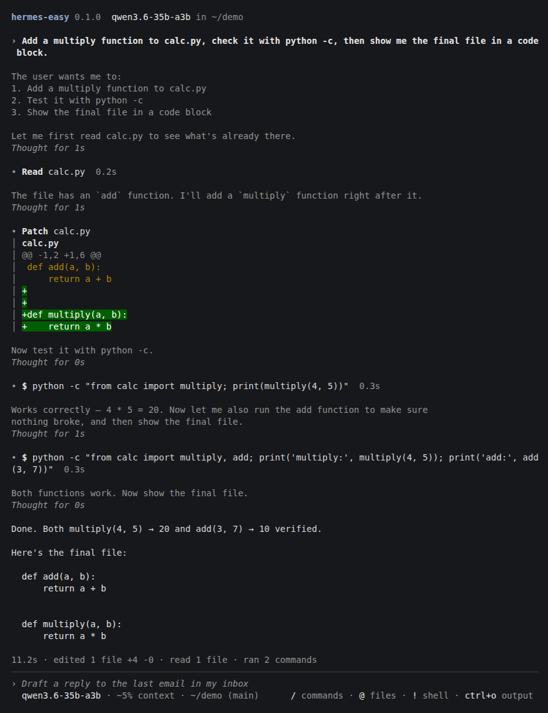
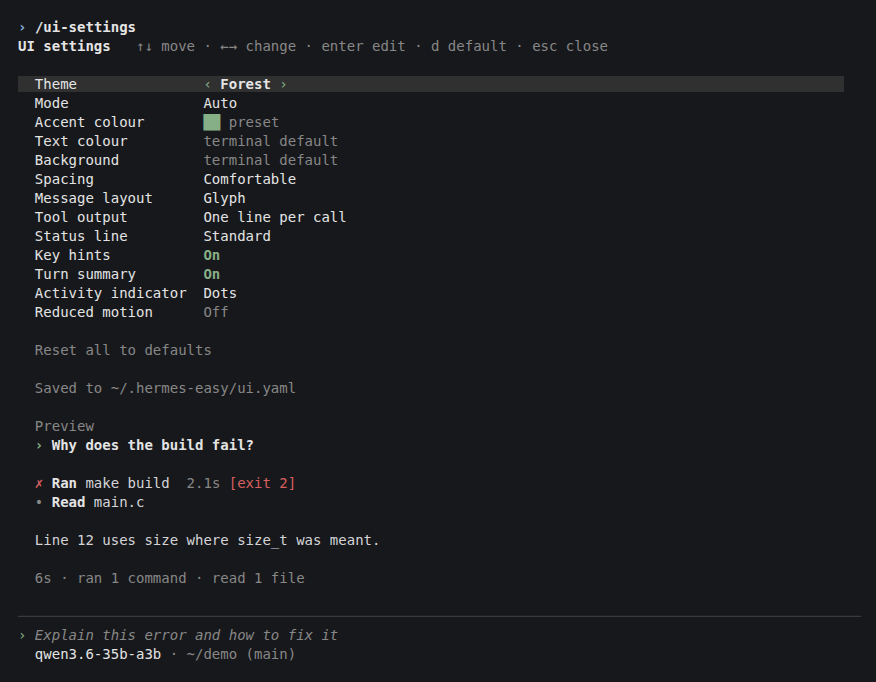
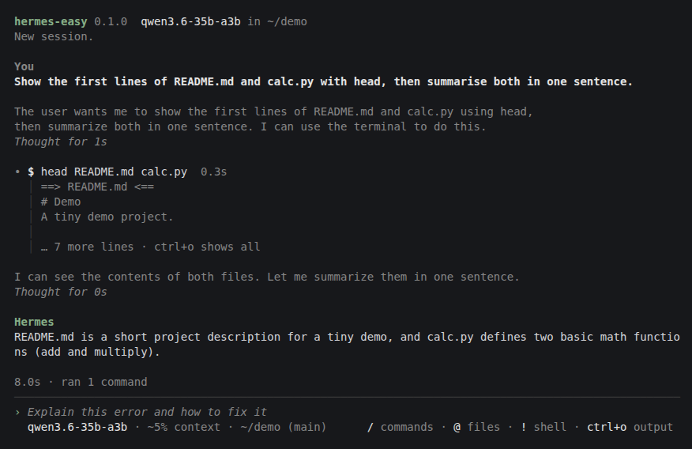

# hermes-easy

A fork of [Hermes Agent](https://github.com/NousResearch/hermes-agent) with a quieter terminal
interface and a `/ui-settings` command for changing it. The agent underneath is upstream's:
tools, skills, memory, MCP, providers, sessions, cron and the messaging gateway all work as they
do in Hermes.



## Credit

hermes-easy is built on **Hermes Agent by [Nous Research](https://nousresearch.com)**
(<https://github.com/NousResearch/hermes-agent>), released under the MIT License. The
[LICENSE](LICENSE) file and its copyright notice are kept unchanged. Upstream's own README is
in [README.upstream.md](README.upstream.md), and its full documentation is at
<https://hermes-agent.nousresearch.com/docs/>.

This fork starts from upstream commit `fd8a6c41ac`. It is not affiliated with or endorsed by
Nous Research; bugs in the interface layer belong here, not upstream.

## Install

You need `git` and [uv](https://docs.astral.sh/uv/getting-started/installation/). uv fetches
Python 3.14 if you don't have it.

```sh
curl -LsSf https://raw.githubusercontent.com/sarja-technologies/hermes-easy/main/scripts/install-hermes-easy.sh | sh
```

The script clones this repository to `~/.local/share/hermes-easy` and installs it as a uv tool,
passing the dependency overrides from `pyproject.toml` (`uv tool install` does not read them
itself). To inspect the script before running it:

```sh
git clone https://github.com/sarja-technologies/hermes-easy ~/.local/share/hermes-easy
sh ~/.local/share/hermes-easy/scripts/install-hermes-easy.sh
```

The install is editable because Hermes loads its skills, locales and plugin manifests from the
source checkout at runtime. Run the installer again to update; `hermes-easy update` prints that
command instead of running upstream's in-place updater.

## Run

```sh
hermes-easy
```

On first launch, pick a model provider with `hermes-easy model` (or the full wizard,
`hermes-easy setup`). If you already use Hermes, copy your model and provider settings across:

```sh
hermes-easy import-upstream          # from ~/.hermes; asks before copying
```

It copies the `model`, `providers`, `custom_providers`, `fallback_model` and `model_aliases`
sections of `config.yaml` and the provider API keys from `.env`. Messaging tokens, gateway
settings, memory and sessions are not copied, and `~/.hermes` is only read.

Every upstream subcommand and flag works under the new name: `hermes-easy -c` resumes the last
session, `hermes-easy gateway`, `hermes-easy cron`, `hermes-easy skills` and so on. Editors that
speak ACP can launch `hermes-easy-acp`.

## Next to an existing Hermes install

- hermes-easy keeps its state in `~/.hermes-easy`. Set `HERMES_HOME` to move it; it refuses to
  run on `~/.hermes`.
- It installs only `hermes-easy` and `hermes-easy-acp`. Your `hermes` command is untouched.
- Inside a hermes-easy session, a `hermes` the agent runs (kanban workers, profile wrappers,
  its own terminal) resolves to hermes-easy through `~/.hermes-easy/bin/hermes`.
- The shared-metrics question upstream asks on first run starts answered "no".
  `hermes-easy setup telemetry` changes it.

## What changed in the interface

- A small launch header shows the version, model and working directory. Use `/tools` and
  `/skills` to see the full inventory.
- Prompts start with `›` and replies with `●`. Use `/reasoning` to change reasoning visibility.
- Tool calls show a concise result. Edits show a diff, and paths inside the working directory appear
  relative to it.
- A one-line summary after each turn: time, files edited, files read, commands run.
- Streamed code blocks use syntax colours for recognized languages and preserve whitespace
  and literal characters when copied from the terminal.
- The composer fills the terminal with a one-cell margin on either side and grows with the draft.
  Use Alt+Enter or Ctrl+J to insert a line, and Up/Down to recall prompts. Slash completions appear
  above the composer.
- The footer shows the active model and approval mode. Decode speed appears when the provider
  supplies decode timings. Shift+Tab on an empty composer opens the approval options.
- A separate activity line shows model and tool progress only while relevant. Use Esc to cancel a
  menu or interrupt a turn, and Ctrl+O to show the latest available tool details.
- `/model` opens the active provider's model list. Use Left to browse providers and type to filter.
- `/clear` redraws the launch line instead of the banner.

## UI settings

`/ui-settings` opens a keyboard-driven settings panel. Changes apply as you make them, show in a preview
inside the panel, and are saved to `~/.hermes-easy/ui.yaml` straight away.



| Key | Action |
| --- | --- |
| `↑` `↓` | Move between settings |
| `←` `→` | Change the value |
| `Enter` | Next value; on a colour row, type `#RRGGBB`; on Reset, press twice |
| `d` | Put the selected setting back to its default |
| `Esc` | Close the panel |

The same settings work without the panel:

```text
/ui-settings show                         list every setting and its value
/ui-settings set layout.spacing compact   change one
/ui-settings preset nordic                switch preset
/ui-settings reset                        back to defaults
/ui-settings path                         where ui.yaml is
```

| Setting | Values | Default |
| --- | --- | --- |
| `theme.preset` | `graphite`, `monochrome`, `nordic`, `forest`, `amber`, `classic` | `graphite` |
| `theme.mode` | `auto`, `dark`, `light` | `auto` |
| `theme.accent` | `#RRGGBB`, or empty for the preset's | empty |
| `theme.foreground` | `#RRGGBB` for answer text, or empty for the terminal's | empty |
| `theme.background` | `#RRGGBB` set on terminals that accept OSC 11, or empty | empty |
| `layout.spacing` | `comfortable`, `compact` | `comfortable` |
| `layout.messages` | `glyph` (`›`), `labeled` (You / Hermes), `ruled` | `glyph` |
| `layout.tool_output` | `compact` (one row), `preview` (first lines), `full`, `hidden` | `compact` |
| `status.line` | `standard`, `minimal`, `full`, `off` | `standard` |
| `status.key_hints` | `true`, `false` | `true` |
| `status.turn_summary` | `true`, `false` | `true` |
| `motion.spinner` | `dots`, `line`, `pulse`, `static` | `dots` |
| `motion.reduced_motion` | `true`, `false` | `false` |

`ui.yaml` can be edited by hand. An unknown key is ignored and an invalid value falls back to
its default with a one-line warning at launch; a broken file never stops hermes-easy starting.
Custom colours need a truecolor terminal (`COLORTERM=truecolor`); elsewhere the presets are
mapped to the 256-colour palette.



## Keys

| Key | Action |
| --- | --- |
| `Enter` | Send |
| `Ctrl+J`, `Alt+Enter` | New line |
| `Tab` | Complete a command or path |
| `Ctrl+C` | Interrupt the agent; on an empty prompt, exit |
| `Ctrl+O` | Show the full output of the last tool call |
| `Ctrl+P` | Command palette |
| `Ctrl+G` | Edit the draft in `$EDITOR` |
| `@` | Attach a file |
| `!` | Run a shell command |

## Not changed

- `hermes-easy --tui` (upstream's Ink interface), the web dashboard and the desktop app look as
  they do upstream.
- Approval and confirmation prompts, the model picker and other modal dialogs keep upstream's
  boxed style.
- Some system messages still carry upstream's emoji.

## Development

```sh
git clone https://github.com/sarja-technologies/hermes-easy && cd hermes-easy
uv venv --python 3.14 .venv && uv pip install --python .venv/bin/python -e ".[dev]"
.venv/bin/python -m pytest tests/hermes_easy
```

The interface layer is in `hermes_easy/`; upstream files touched are listed in the commit that
introduces it. The screenshots above are captures of hermes-easy running in tmux (100 columns,
truecolor, a local `qwen3.6-35b-a3b` model behind an OpenAI-compatible endpoint), rendered to
PNG with `scripts/easy_screenshot.py`.

## License

MIT, as upstream. See [LICENSE](LICENSE): Copyright (c) 2025 Nous Research.
